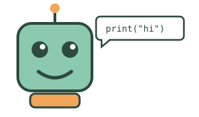

```text
 ██████╗  █████╗            █████╗ ██╗ █████╗
██╔═══██╗██╔══██╗          ██╔══██╗██║██╔══██╗
██║   ██║███████║  ██████  ███████║██║███████║
██║▄▄ ██║██╔══██║  ╚═════  ██╔══██║██║██╔══██║
╚██████╔╝██║  ██║          ██║  ██║██║██║  ██║
 ╚══▀▀═╝ ╚═╝  ╚═╝          ╚═╝  ╚═╝╚═╝╚═╝  ╚═╝

 __  __   ___   ____   _   _  _      _____     _  _
|  \/  | / _ \ |  _ \ | | | || |    | ____|   | || |
| |\/| || | | || | | || | | || |    |  _|     | || |_
| |  | || |_| || |_| || |_| || |___ | |___    |__   _|
|_|  |_| \___/ |____/  \___/ |_____||_____|      |_|

AI-ASSISTED SCRIPTING
```

<p align="center">
  
</p>

<p align="center">
  
  
  
  
  
</p>

> *Scripts that work, mostly on the first try.*
> Python, AI assistance, and a healthy amount of vibe coding.

This repository holds the hands-on labs for the **AI Assisted Scripting: Low-code Pathway**. You will use AI tools to write, improve, test and document small Python automations, then check your work against the exercise guide.

It also holds the Day 4 workshop (a football match monitor, built in stages), and a small web site that puts the weather, postcode and football tools next to the Module 1-8 lab files.

---

## 🗺️ Module progress

`Labs done  ████████████████████  100%  (8 of 8 modules)`

| Module | Topic | Status | Where to look |
|---|---|---|---|
| 1 | Tools walkthrough | 📝 Worksheet | [`DAY1-Labs/Module-1 Lab/`](DAY1-Labs/Module-1%20Lab/) |
| 2 | Define an automation solution | 📝 Worksheet (write-up, no code) | [`DAY1-Labs/Module-2 Lab/`](DAY1-Labs/Module-2%20Lab/) |
| 3 | Generate your first script | ✅ Done | [`DAY1-Labs/Module-3 Lab/tv_show_search.py`](DAY1-Labs/Module-3%20Lab/tv_show_search.py) |
| 4 | Improve AI-generated code | ✅ Done | [`DAY1-Labs/Module-4 Lab/improved_search.py`](DAY1-Labs/Module-4%20Lab/improved_search.py) |
| 5 | Retrieve TV show data from an API | ✅ Done | [`DAY1-Labs/Module-5 Lab/`](DAY1-Labs/Module-5%20Lab/) |
| 6 | Externalise configuration | ✅ Done | [`DAY1-Labs/Module-6 Lab/`](DAY1-Labs/Module-6%20Lab/) |
| 7 | Test and break the automation | ✅ Done | [`DAY1-Labs/Module-7 Lab/test_log.md`](DAY1-Labs/Module-7%20Lab/test_log.md) |
| 8 | Prepare for workplace use | ✅ Done | [`DAY1-Labs/Module-8 Lab/`](DAY1-Labs/Module-8%20Lab/) |
| Workshop | Football match monitor (Day 4) | 🚧 Parts 2-8 built, worksheet is a draft | [`DAY4-Workshop/football-monitor/`](DAY4-Workshop/football-monitor/) |

### Optional tasks

| Task | Topic | Status | Where to look |
|---|---|---|---|
| 2 | Current weather for a location | ✅ Done | [`Optional/Optional-Task-2/`](Optional/Optional-Task-2/) |
| 3 | UK postcode to GPS coordinates, offline | ✅ Done | [`Optional/Optional-Task-3/`](Optional/Optional-Task-3/) |
| 4 | Split the Task 3 code across several files | ✅ Done | [`Optional/Optional-Task-4/`](Optional/Optional-Task-4/) |
| 5 | Income tax calculator with bands in a config file | ✅ Done | [`Optional/Optional-Task-5/`](Optional/Optional-Task-5/) |

The task briefs are in [`Optional/optional_tasks.md`](Optional/optional_tasks.md).

---

## 📁 What is in here

```
.
├── EG_01_Exercise_Guide.md     # Full course exercise guide (converted from PDF)
├── hello.py                    # The obligatory first script
├── DAY1-Labs/                  # Day 1: setup tasks, sales data and the Module 1-8 labs
│   ├── Setup Task 1 - ...txt   # Launch the lab VM, mount the D: drive
│   ├── Setup Task 2 - ...txt   # Install PyCharm
│   ├── Setup Task 3 - ...txt   # Create a GitHub account (use the VM!)
│   ├── sales_messy.csv         # Original data, deliberately chaotic
│   ├── sales_clean.csv         # Cleaned version (see "Known issues")
│   ├── Module-1 Lab/           # Automation planning worksheet
│   ├── Module-2 Lab/           # Lab brief and automation worksheet
│   ├── Module-3 Lab/           # Search script: welcome, prompt, summary
│   ├── Module-4 Lab/           # AI-generated script, refactored for humans
│   ├── Module-5 Lab/           # TVMaze API script, with README and sample output
│   ├── Module-6 Lab/           # TVMaze script that reads config.json
│   ├── Module-7 Lab/           # Test log for the TVMaze automation
│   └── Module-8 Lab/           # Script with logging, automation.log and README
├── DAY2/                       # Placeholder (test.py only)
├── DAY3/                       # Placeholder (empty)
├── DAY4-Workshop/              # Day 4 workshop (exercise guide, section 2)
│   ├── football-monitor/       # One folder per workshop part, each a snapshot
│   │   ├── part1-define-solution/   # Automation worksheet (draft)
│   │   ├── part2-starting-script/   # Call the ESPN API and print matches
│   │   ├── part3-process-data/      # Home, away, status and score
│   │   ├── part4-business-rules/    # Team filter
│   │   ├── part5-configuration/     # config.json and the report file
│   │   ├── part6-test-validate/     # test_results.txt
│   │   ├── part7-logging/           # automation.log
│   │   └── part8-documentation/     # Final version with its own README
│   └── module-solutions/       # Empty folders for the module solutions
├── Optional/                   # Optional tasks
│   ├── optional_tasks.md       # The task briefs
│   ├── Optional-Task-2/        # Weather lookup (terminal script)
│   ├── Optional-Task-3/        # Postcode lookup (terminal script) and offline data
│   │   ├── data/uk_postcodes.csv.gz    # Live UK postcodes and coordinates (ONS, May 2026)
│   │   └── build_postcode_data.py      # Rebuilds the data file from the full ONS CSV
│   ├── Optional-Task-4/        # The Task 3 lookup split into main, data and lookup files
│   └── Optional-Task-5/        # Income tax calculator, tax_bands.json and tests
│       └── workshop/           # Two-band part 1 and the part 2 brief
└── web/                        # Web site: home, weather, postcodes, football and Modules 1-8
    ├── server.py               # Standard-library server and JSON endpoints
    ├── modules.py              # List of lab files the site may show
    └── index.html              # React page (loaded from a CDN)
```

---

## 🚀 Quick start

You need **Python 3.9 or newer**. Nothing else needs installing: every script uses the standard library.

```bash
# Hello, world
python3 hello.py

# Module 3: search with a welcome banner and summary
python3 "DAY1-Labs/Module-3 Lab/tv_show_search.py"

# Module 4: the refactored search script
python3 "DAY1-Labs/Module-4 Lab/improved_search.py"

# Module 5: live TVMaze search (needs internet)
cd "DAY1-Labs/Module-5 Lab" && python3 tvmaze_search.py

# Module 6: the same search, with settings read from config.json
cd "DAY1-Labs/Module-6 Lab" && python3 tvmaze_search.py

# Module 8: the same search, with logging to automation.log
cd "DAY1-Labs/Module-8 Lab" && python3 tvmaze_search.py

# Optional Task 2: current weather for a place (needs internet)
python3 "Optional/Optional-Task-2/weather.py"

# Optional Task 3: postcode to coordinates (works offline)
python3 "Optional/Optional-Task-3/postcode_lookup.py"

# Optional Task 4: the same lookup, split across several files (reads Task 3's data)
python3 "Optional/Optional-Task-4/main.py"

# Optional Task 5: income tax calculator, then its tests
python3 "Optional/Optional-Task-5/tax_calculator.py"
cd "Optional/Optional-Task-5" && python3 -m unittest

# Day 4 workshop: the finished football monitor (needs internet), then its settings
cd "DAY4-Workshop/football-monitor/part8-documentation" && python3 football_monitor.py
```

The football monitor reads `config.json` in its folder, writes `football_report.txt` and logs to `automation.log`. See the [part 8 README](DAY4-Workshop/football-monitor/part8-documentation/README.md) for the settings.

### Web site

The site opens on a home page with the introduction from the top of this README, from the QA AIA banner through the line about the Module 1-8 lab files. The other pages are weather and postcodes, a football match monitor, the Module 1-8 lab files, and the module solutions. The football page uses the part 8 code from the workshop.

```bash
cd web
python3 server.py
```

Then open http://127.0.0.1:8000. To use another port, set `PORT`:

```bash
PORT=8001 python3 server.py
```

The page loads React from a CDN. The weather and football panels need internet access. The postcode panel works offline.

Module 5 has its own [README](DAY1-Labs/Module-5%20Lab/README.md) and Module 8 has one too, [DAY1-Labs/Module-8 Lab/README.md](DAY1-Labs/Module-8%20Lab/README.md).

---

## 🧪 Vibe check

| Check | Result |
|---|---|
| `hello.py` prints `hello` | ✅ Pass |
| Module 3 accepts a search term and prints a summary | ✅ Pass |
| Module 3 rejects an empty search term | ✅ Pass |
| Module 4 output matches the original AI script | ✅ Pass |
| Module 5 returns real shows from TVMaze | ✅ Pass |
| Module 5 says "No rating" instead of crashing | ✅ Pass |
| Module 7 test log: all five test cases pass | ✅ Pass |
| Module 8 writes errors to `automation.log` | ✅ Pass |
| Postcode lookup finds SW1A 1AA and rejects malformed input | ✅ Pass |
| Optional Task 4 gives the same results as Task 3 | ✅ Pass |
| Optional Task 5 tests (16) | ✅ Pass |
| Football monitor tests, parts 6 to 8 (8 each) | ✅ Pass |
| Site API returns weather, postcode and football results | ✅ Pass |
| Site pages render and work in a browser (headless Chrome) | ✅ Pass |
| The AI never said "Certainly!" in the commit messages | 🤞 Unverified |

---

## 🐛 Known issues

- **The sales data is still a bit messy.** `sales_clean.csv` has four blanks where the source data was missing a value: Quantity (ORD1006), Salesperson (ORD1019), Date (ORD1021) and Order_ID (last row). Order ORD1018 is also missing from the sequence. These are left blank on purpose rather than guessed.
- **The Module 3 and Module 4 scripts simulate data.** They don't call a real service. That's intentional for those labs.
- **Modules 5 to 8, the weather task and the football monitor need internet access** to call TVMaze, Open-Meteo or ESPN.
- **The football monitor only sees the current matchday** unless `config.json` has a `date` (`YYYYMMDD`). With the example team, Celtic, the report often says "No matches found". Try `"date": "20261121"`.
- **The football worksheet (part 1) is a draft.** Some items are marked TBC.
- **Optional Task 4 reads Task 3's data file** rather than carrying its own copy of the 16 MB file.
- **Two tax calculators.** `Optional-Task-5/` has the full four-band version. `Optional-Task-5/workshop/` has the two-band part 1 for the Day 4 task.
- **Module 2 is a worksheet, not code.** The completed worksheet is in `DAY1-Labs/Module-2 Lab/automation_worksheet.md`.
- **The TVMaze search returns only about 10 matches,** so a broad term such as `comedy` may show nothing at a high minimum rating.
- **The rating range isn't checked.** A minimum rating outside 0 to 10 shows "No shows found" rather than an error.
- **Network failure in Module 8 isn't triggered in testing.** The error path is in the code, but the log has no example of it yet.
- **The postcode data is about 16 MB.** It comes from the ONS National Statistics Postcode Lookup (May 2026), and it's stored in the repo so the postcode lookup works offline.

---

## 🤖 Working in this repo

- Use **AI tools** to generate and improve code, but **check every change** before you trust it. The guide's own rule: *AI can suggest, learners must verify.*
- Keep each lab in its own `Module-N Lab/` folder under `DAY1-Labs/`, each optional task in its own `Optional-Task-N/` folder, and each workshop part in its own folder under `DAY4-Workshop/`.
- Commit messages should say what changed and why.

---

## 📜 Licence and credits

Course material is © QA Limited, from the *AI Assisted Scripting: Low-code Pathway*. The lab scripts in this repository were written as learning examples. The postcode data is from the ONS, published under the Open Government Licence.

> 🥠 *Fortune cookie says: your code will run. Eventually. Probably after one traceback.*

*This repository may contain traces of AI. Results may vary. Works on my machine.* 🧑‍💻
